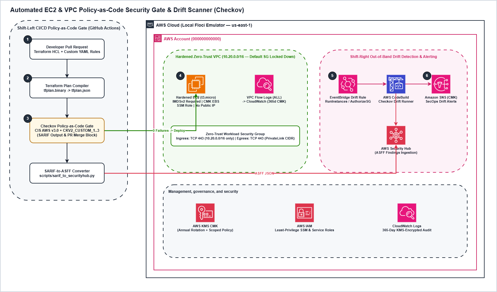

# Automated EC2 and VPC Policy-as-Code Security Gate and Drift Scanner (Checkov)

An enterprise-grade Infrastructure-as-Code (IaC) security gate and continuous drift detection pipeline built with **Terraform**, **Checkov**, **Python (Boto3)**, **GitHub Actions**, and **AWS** (emulated locally in **Floci**).

This project enforces **CIS AWS Foundations Benchmark v3.0+**, **NIST SP 800-53 Rev. 5**, and **CSA Cloud Controls Matrix (CCM) v4.1** guardrails across both **Shift-Left** pull requests (blocking insecure Terraform plans before deployment) and **Shift-Right** runtime operations (detecting out-of-band EC2 and Security Group configuration drift).

---

## Architecture Overview



### How the End-to-End Pipeline Works

1. **Developer Pull Request and Terraform Plan Compilation (Steps 1-2):**
   When an engineer proposes EC2 or VPC infrastructure changes, the pipeline runs `terraform plan -out=tfplan.binary` and converts the binary plan into machine-readable JSON via `terraform show -json tfplan.binary > tfplan.json`. Scanning compiled plan JSON rather than raw `.tf` files ensures that input variables (`var.approved_ami_id`), local expressions, and `count`/`for_each` resource expansions are evaluated using the exact values AWS will receive.

2. **Checkov Static Compliance and Custom Organizational Policy Gate (Step 3):**
   Checkov evaluates `tfplan.json` against built-in CIS/NIST AWS checks as well as custom organizational YAML rules (`CKV2_CUSTOM_1` through `CKV2_CUSTOM_3`) located in `custom-policies/`. Any violation fails the pipeline with a non-zero exit code, generates a **SARIF** report (`results_sarif.sarif`), and blocks `terraform apply`.

3. **Zero-Trust Hardened Workload Provisioning (Step 4):**
   Once Checkov reports zero failures, Terraform provisions the compliant infrastructure in `envs/hardened-zero-trust/`:
   * **VPC Network Isolation:** A dedicated VPC (`10.20.0.0/16`) with its default security group completely locked down (`aws_default_security_group` with zero ingress/egress rules), private workload subnets (`map_public_ip_on_launch = false`), and KMS-encrypted VPC Flow Logs capturing `ALL` traffic to CloudWatch Logs with 365-day retention.
   * **Zero-Trust Security Group:** Denies SSH (port 22) and RDP (port 3389) entirely, restricts inbound HTTPS (port 443) strictly to internal VPC CIDR traffic, and scopes outbound traffic to port 443 within the VPC CIDR for AWS PrivateLink endpoints.
   * **Hardened EC2 Compute:** Launches from an approved CIS Golden AMI (`ami-0c55b159cbfafe1f0`), enforces **IMDSv2** (`http_tokens = "required"`, hop limit `1`) to prevent SSRF credential theft, encrypts the root `gp3` EBS volume using a Customer Managed KMS Key (CMK) with automatic annual rotation, enables detailed monitoring, and attaches a least-privilege IAM instance profile (`AmazonSSMManagedInstanceCore`) for bastion-free AWS Systems Manager access.

4. **Shift-Right Out-of-Band Drift Detection and ASFF Alerting (Steps 5-6):**
   * **EventBridge + CodeBuild Drift Runner:** An Amazon EventBridge rule monitors CloudTrail management events for out-of-band mutations (`RunInstances`, `AuthorizeSecurityGroupIngress`, `ModifyInstanceMetadataOptions`) and triggers an AWS CodeBuild container running Checkov drift validation.
   * **SARIF-to-ASFF Security Hub & SNS Pipeline:** `scripts/sarif_to_securityhub.py` converts Checkov SARIF findings into AWS Security Finding Format (`asff_findings.json`), imports findings into AWS Security Hub via `BatchImportFindings`, and publishes alerts to a KMS-encrypted SNS topic (`ec2-vpc-drift-alerts-junlab`).

---

## Troubleshooting

During local engineering and verification in WSL Ubuntu and Floci, six technical issues were encountered and fixed:

1. **KMS Key Policy Flagged by Generic IAM Rules (`CKV_AWS_356`, `CKV_AWS_111`, `CKV_AWS_109`):**
   * *Symptom:* Checkov failed `aws_iam_policy_document.infra_kms_policy` because a single `kms:*` statement on `resources = ["*"]` triggered generic IAM resource and write-constraint checks.
   * *Fix:* Split `kms.tf` into three least-privilege statements separating administration from cryptographic usage, constrained with `aws:PrincipalAccount`, `kms:ViaService`, `kms:CallerAccount`, and `kms:EncryptionContext` conditions.

2. **CodeBuild Project Missing Audit Logging (`CKV_AWS_314`):**
   * *Symptom:* Checkov flagged `aws_codebuild_project.checkov_drift_scanner` for lacking a `logs_config` block.
   * *Fix:* Created a 365-day KMS-encrypted CloudWatch Log Group (`/aws/codebuild/checkov-drift-scanner-junlab`) in `observability.tf` and attached it to `logs_config`.

3. **AWS CLI Returning Empty Output Without `--endpoint-url`:**
   * *Symptom:* Running `aws ec2 describe-instances` with only `AWS_ENDPOINT_URL` exported returned empty tables on older AWS CLI v2 builds.
   * *Fix:* Passed `--endpoint-url=http://localhost:4566` explicitly on all AWS CLI commands to force routing to Floci.

4. **Checkov SARIF Output Filename Convention (`results_sarif.sarif`):**
   * *Symptom:* Passing `-o sarif --output-file-path .` generated `./results_sarif.sarif` rather than `results.sarif`.
   * *Fix:* Updated `scripts/sarif_to_securityhub.py` to default to `results_sarif.sarif`.

5. **Ubuntu PEP 668 System Python Isolation (`ModuleNotFoundError: No module named boto3`):**
   * *Symptom:* Invoking system `python3` failed to locate `boto3` and `checkov`.
   * *Fix:* Executed automation scripts directly via `/opt/secops-venv/bin/python`.

6. **Floci Security Hub Ingestion API Parity (`UnknownOperationException: POST /findings/import`):**
   * *Symptom:* Floci supports Security Hub control-plane enablement (`EnableSecurityHub` / `DescribeHub`) but does not implement `BatchImportFindings` (`POST /findings/import`) or `GetFindings` (`POST /findings`).
   * *Fix:* Updated `scripts/sarif_to_securityhub.py` to persist normalized ASFF findings to `asff_findings.json` and automatically fall back to publishing a violation summary to the KMS-encrypted SNS topic (`ec2-vpc-drift-alerts-junlab`) when `UnknownOperationException` occurs locally.

---

## Lessons Learned

* **Plan-Level Scanning (`tfplan.json`) Eliminates Static IaC Blind Spots:** Evaluating raw HCL files cannot verify resolved variable values, dynamic blocks, or `for_each` resource expansions. Compiling `tfplan.binary` into `tfplan.json` ensures the Policy-as-Code gate inspects the exact infrastructure attributes AWS will provision (`CSA CCC-04`).
* **Shift-Left and Shift-Right Controls Must Work Together:** Blocking misconfigured pull requests in GitHub Actions stops bad IaC from merging, while EventBridge + CodeBuild drift detection closes the loop against out-of-band console or CLI changes (`NIST CM-3`, `SI-4`).
* **Strict Policy-as-Code Exposes Subtle Least-Privilege Gaps:** Running Checkov at zero-failure strictness forces proper scoping on resources engineers often overlook—such as locking down VPC default security groups (`CKV2_AWS_12`), enforcing 365-day KMS-encrypted CloudWatch retention (`CKV_AWS_338`, `CKV_AWS_158`), and adding `kms:ViaService` conditions to CMK policies (`CKV_AWS_356`).
* **Design Automation Scripts with Graceful Emulator Fallbacks:** Local AWS emulators like Floci accelerate infrastructure iteration at zero cloud cost, but building clean fallback paths (such as exporting `asff_findings.json` and alerting via SNS when Security Hub ingestion APIs are unavailable locally) keeps pipelines portable between local labs and production AWS accounts.

---

## Repository Structure

```text
ec2-vpc-policy-gate/
├── .github/
│   └── workflows/
│       └── checkov-security-gate.yml       # Shift-Left GitHub Actions PR gate & SARIF uploader
├── custom-policies/
│   ├── mandatory_tags.yaml                 # CKV2_CUSTOM_1: Enforces Owner, Environment, DataClassification tags
│   ├── approved_ami.yaml                   # CKV2_CUSTOM_2: Enforces approved CIS Golden AMI allowlist
│   └── restricted_instance_types.yaml      # CKV2_CUSTOM_3: Restricts compute to t3.micro/small/medium
├── envs/
│   ├── vulnerable-baseline/                # Intentionally insecure baseline (16 Checkov failures)
│   │   ├── providers.tf
│   │   ├── vpc.tf
│   │   └── ec2.tf
│   └── hardened-zero-trust/                # Compliant production-grade modular stack (0 failures)
│       ├── backend.tf                      # Remote S3 state backend with native state locking
│       ├── providers.tf                    # AWS provider with default governance tags
│       ├── variables.tf                    # Parameterized inputs
│       ├── kms.tf                          # KMS CMK with annual rotation and scoped key policy
│       ├── iam.tf                          # Least-privilege EC2 SSM and VPC Flow Logs roles
│       ├── observability.tf                # 365-day KMS-encrypted CloudWatch Log Groups
│       ├── vpc.tf                          # VPC, locked default SG, private subnet, Flow Logs, workload SG
│       ├── ec2.tf                          # IMDSv2-enforced, CMK-encrypted EC2 instance
│       ├── drift_scanner.tf                # EventBridge rule, CodeBuild Checkov runner, KMS SNS topic
│       └── outputs.tf                      # VPC ID, EC2 Instance ID, and KMS Key ARN outputs
├── scripts/
│   └── sarif_to_securityhub.py             # Converts Checkov SARIF to ASFF JSON & imports to Security Hub / SNS
├── architecture.png                        # Exported AWS reference architecture diagram
└── README.md
